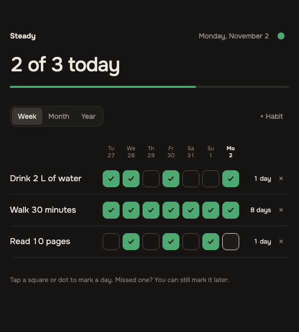
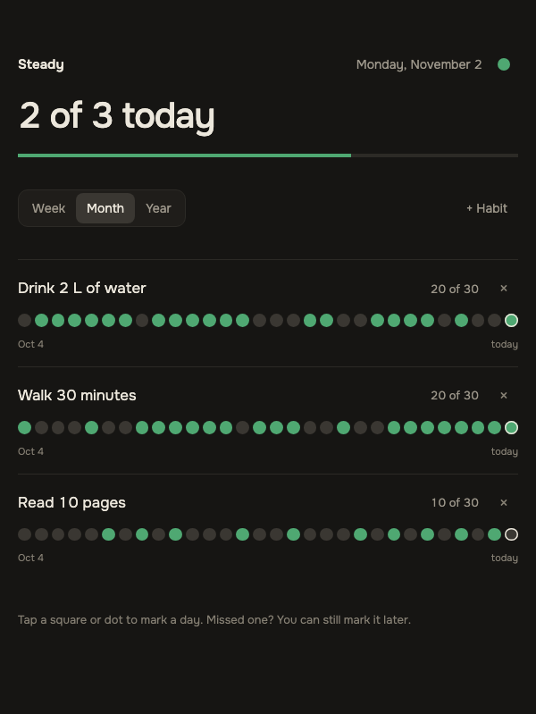
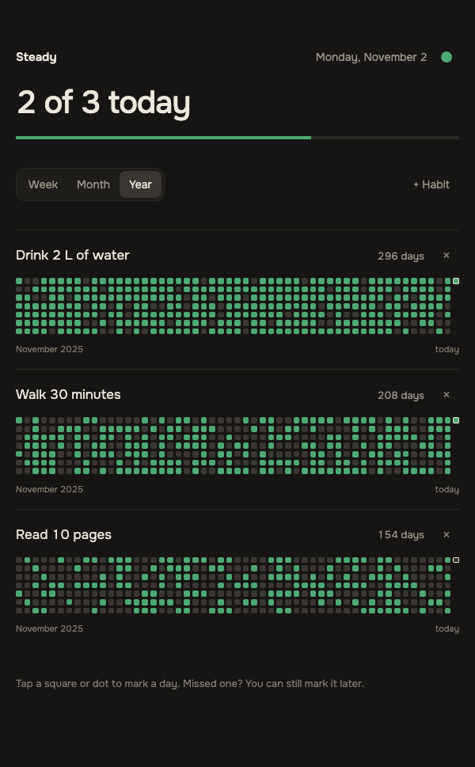
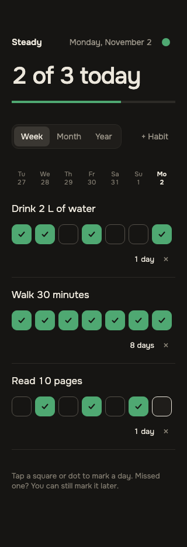

# Steady

Steady is a minimal single-page habit tracker. Mark each day of a habit as done on a week, month or year view, follow the streak and today's progress, and pick one of ten accent colors. Deleting a habit shows a toast with Undo. One Go binary serves the embedded TypeScript frontend, which has no runtime dependencies, and keeps all data in one SQLite file. Private username/password accounts each have separate habits, marks, ordering and settings. The operator manages accounts through the server-side CLI; there is no public registration.

## Screenshots

These are made-up demo data.

| Week | Month | Year |
| --- | --- | --- |
|  |  |  |

The same page at 320 px wide, the narrowest width it reflows to:



## Quick start

Requirements: Go (the version in `go.mod` or newer).

```sh
go install github.com/scv3lqq/steady/cmd/steady@latest
steady account bootstrap owner
STEADY_COOKIE_SECURE=false steady
```

`go install` puts the binary in `$GOBIN`, or in `$(go env GOPATH)/bin` when `GOBIN` is not set. Open <http://127.0.0.1:8770> and sign in. Bootstrap creates `data/steady.db` in the current directory and asks for the owner's password twice with terminal echo disabled. `STEADY_COOKIE_SECURE=false` is an explicit exception for local HTTP; use the default `true` behind an HTTPS reverse proxy.

## Accounts

Run these commands on the server with the same `STEADY_DB` and filesystem user as the service, in an interactive terminal:

```sh
steady account bootstrap owner
steady account create reader
steady account reset-password reader
```

Usernames are case-sensitive lowercase ASCII matching `[a-z][a-z0-9_-]{2,31}` (3 to 32 characters). Passwords must be valid UTF-8, 12 to 128 bytes, with no truncation or additional composition rules. Every command reads the password and confirmation from a hidden terminal prompt. Password arguments, environment variables and piped input are not supported. There is no remote account creation, signup, invitation, admin UI, email, OAuth or password recovery flow.

`bootstrap` transactionally creates the owner, assigns every legacy habit, day mark, position, setting and soft-deleted habit, and records ownership. An exact same-username retry is a no-op: it does not change the password or reassign data. A different username after bootstrap is rejected. Until bootstrap, legacy data remains inaccessible over HTTP and is never assigned to a browser visitor. `create` gives a new user no habits, week view and accent `#4FA872`; duplicate usernames are rejected. `reset-password` atomically changes the password and revokes all of that user's sessions, including a concurrent login using the old password.

Sessions last 30 days from login without sliding renewal and survive server restarts. Logout revokes the current session. Expiry and logout clear private browser state before another account signs in. Each queued private request captures its session binding, and native `BroadcastChannel('steady-auth')` messages clear other tabs' private state, DOM and pending work on authentication transitions without broadcasting identity or credentials. For an existing installation, follow the [private-account upgrade procedure](deploy/README.md#upgrade-to-private-accounts) before starting the new binary.

From a clone, `make run` builds the frontend and starts the server with the default configuration. That also needs Node.js and npm.

## Configuration

Steady reads five environment variables. An unset or empty variable uses its default. Invalid configuration stops the server at startup with a message that names the variable. [`.env.example`](.env.example) lists the defaults; the server does not read a `.env` file itself, so export the values in your shell or service unit.

| Variable | Default | Meaning |
| --- | --- | --- |
| `STEADY_ADDR` | `127.0.0.1:8770` | Listen address as `host:port`. Keep it on a loopback address, see [Security](#security). |
| `STEADY_DB` | `data/steady.db` | Path of the SQLite file. A missing directory is created. |
| `STEADY_LOG_LEVEL` | `info` | One of `trace`, `debug`, `info`, `warn`, `error`, `fatal`, `panic`, in any letter case. Logs are JSON lines on stderr. |
| `STEADY_ALLOWED_HOSTS` | empty | Comma-separated extra `Host` values to accept, for a reverse proxy, for example `habits.example.com`. An entry without a port matches that name on any port, an entry with a port must equal the whole `Host` header. |
| `STEADY_COOKIE_SECURE` | `true` | Send the session cookie only over HTTPS. Set explicitly to `false` only for local HTTP on loopback or through an SSH tunnel. Forwarded headers never determine this setting. |

## API

The frontend talks to this JSON API. All habit and settings routes require a valid server-side session; identity is derived from that session, and a supplied habit ID grants no access to another user's data. IDs are lowercase UUIDs made by the client, days are `YYYY-MM-DD` keys built in the browser's local time zone. Every private API request also sends `X-Steady-Session` with the binding returned by `/api/session`: SHA-256 hex of the UTF-8 string `steady-request:` followed by the raw opaque token. The server compares this request-context marker in constant time against the validated cookie session; absent or stale bindings receive 401 even if the browser has switched to another account cookie. The marker cannot authenticate without the cookie and is not a reusable session token. Missing, revoked or expired sessions receive 401. Auth responses and private data use `Cache-Control: no-store`.

| Route | What it does |
| --- | --- |
| `POST /api/login` | Accepts `{"username":"...","password":"..."}`, creates a session cookie and answers 204; invalid credentials receive a generic 401. |
| `POST /api/logout` | Revokes the current session and clears the cookie (204); no valid session is also 204. |
| `GET /api/session` | Returns `{"username":"...","binding":"<sha256-hex>"}` for the validated cookie session, otherwise 401; this discovery request does not require the binding header. |
| `GET /api/state` | Returns the current user's habits with their done days, plus their saved `view` and `accent`. |
| `POST /api/habits` | Creates a habit from `{"id": "<uuid>", "name": "..."}` and answers 201; a taken id is 409. |
| `PATCH /api/habits/{id}` | Renames a habit from `{"name": "..."}`; `name` is required. |
| `DELETE /api/habits/{id}` | Soft-deletes a habit, so that it can be restored (204). |
| `POST /api/habits/{id}/restore` | Restores a deleted habit at its original position (204). |
| `PUT /api/habits/{id}/days/{day}` | Marks a day done (204, repeating it changes nothing). |
| `DELETE /api/habits/{id}/days/{day}` | Clears a day (204, repeating it changes nothing). |
| `PUT /api/settings` | Saves `view` (`week`, `month` or `year`) and `accent` (one of the ten palette colors); both are optional, at least one is required (204). |
| `GET /healthz` | Answers `{"status":"ok"}`, or 503 when the database does not answer. |
| `GET /` | The page (`index.html`). |
| `GET /styles.css` | The stylesheet. |
| `GET /dist/{file}` | A compiled script; any other name is 404. |

API errors are JSON, `{"error":"<text>"}`: 400 for invalid input (for example a name longer than 60 characters), 401 for missing authentication or generic invalid credentials, 404 `habit not found` (including another user's habit ID), 409 `habit already exists`, 403 when the Host or cross-origin check rejects the request, 429 for bounded login rate limiting, 500 `internal error`. A request body is at most 4096 bytes, one JSON object, no unknown fields. A blank habit name becomes `Untitled`. `/healthz` remains unauthenticated for deployment checks.

## Security

Steady authenticates private accounts and enforces ownership in repository queries for reads and every mutation, including day marks, delete and Undo. It listens on `127.0.0.1` by default; keep the backend on loopback and use HTTPS for remote browser access.

- Local HTTP or SSH tunnel: explicitly set `STEADY_COOKIE_SECURE=false`, restart, then browse to <http://127.0.0.1:8770>. A tunnel uses `ssh -N -L 8770:127.0.0.1:8770 <user>@<server>`. This exception sends the cookie over local HTTP and must not be used for a public HTTP endpoint.
- HTTPS reverse proxy: retain `STEADY_COOKIE_SECURE=true`, terminate TLS at the proxy, forward the original `Host`, and list the public host in `STEADY_ALLOWED_HOSTS`. Cookies are `HttpOnly`, `SameSite=Strict`, `Path=/`, with no Domain attribute. Secure is explicit configuration, independent of `Forwarded` and `X-Forwarded-*` headers.
- Passwords use Argon2id from maintained [`golang.org/x/crypto/argon2`](https://pkg.go.dev/golang.org/x/crypto/argon2), with the [RFC 9106 second recommended profile](https://www.rfc-editor.org/rfc/rfc9106.html#section-4): 64 MiB, 3 iterations, 4 lanes, a random 16-byte salt and a 32-byte key, stored in PHC format. Passwords are never logged or printed.
- Each opaque session contains 32 cryptographically random bytes; only its SHA-256 hash is persisted. Absolute expiry is 30 days; logout revokes the current token and password reset revokes every token for that account atomically.
- Login is limited to 5 attempts per source IP per 15 minutes, 30 attempts globally per minute and 2 concurrent password hashes. The IP map holds at most 1024 entries, prunes expired entries and fails closed when full. Only `RemoteAddr` is trusted; forwarded client-IP headers are ignored. Failed credentials use the same generic response for unknown usernames and wrong passwords. Credentials, session tokens and private operational details must stay out of logs and public artifacts.

What the server enforces itself:

- A Host allowlist against DNS rebinding. It accepts `localhost`, `127.0.0.1` and `::1` on any port (so a tunnel on another local port works), the listen address (`STEADY_ADDR`) and the `STEADY_ALLOWED_HOSTS` entries. Any other `Host` gets `403 host not allowed`.
- `http.CrossOriginProtection` from the standard library. It rejects cross-origin browser requests that use an unsafe method, which covers every route that changes data, with `403 cross-origin request rejected`.
- A Content-Security-Policy on every response. The page may load only its own script, stylesheet and images, plus the Onest font from Google Fonts (the browser asks Google for the font), may connect only to itself, and may not be framed. Responses also carry `X-Content-Type-Options: nosniff`, `Referrer-Policy: no-referrer` and `Cache-Control: no-store`.

## Data

Everything lives in one SQLite file, `data/steady.db` by default (`STEADY_DB`), in WAL mode: while the server runs, `-wal` and `-shm` files sit next to it. Schema migrations are embedded in the binary and run when the repository is opened by the server or account CLI. New accounts start empty with default settings; there is no demo seed. Existing unowned rows remain preserved and inaccessible until explicit CLI bootstrap assigns them transactionally.

Back it up with `sqlite3 <db> ".backup <file>"` or `sqlite3 <db> "VACUUM INTO '<file>'"`; either gives a consistent copy while the server runs. Never copy the live file without its `-wal` file: the newest writes are kept there until a checkpoint.

Deleting a habit hides it at once and keeps its row, so Undo can bring it back at its original position. A purge removes owned habits deleted more than 24 hours ago for good; it runs on startup and on each delete. Migration marks existing soft-deleted rows `legacy_preserved`; purge excludes both unowned and preserved rows, including after bootstrap and restart. Restore clears preservation, so a later explicit delete follows ordinary 24-hour retention. Backups contain password hashes and session hashes as well as habits: restrict access to the service user and root. Never run an old unauthenticated binary against the migrated database or perform a destructive schema downgrade; restore the protected pre-upgrade backup with its matching binary offline if recovery is needed.

## Deploy

[`deploy/README.md`](deploy/README.md) describes the server kit: a hardened systemd service under its own user and an optional pull-based auto-deploy of `main` that checks the commit signature and CI. The first private-account upgrade requires the documented stopped-service backup/bootstrap procedure with auto-deploy disabled. Health-only binary rollback cannot safely cross this schema and authentication boundary.

Pushing a tag named `steady/vX.Y.Z` runs the release workflow. It builds static binaries (`CGO_ENABLED=0`) for linux and darwin on amd64 and arm64, and publishes a GitHub release with the files `steady-vX.Y.Z-<os>-<arch>` and a `SHA256SUMS` file. Each binary also gets a build provenance attestation. Attestations need a public repository on a personal plan: a tag pushed while the repository is private fails at the attestation step and publishes no release. To verify a downloaded binary:

```sh
gh attestation verify steady-vX.Y.Z-linux-amd64 --repo scv3lqq/steady
```

## Development

You need Go, Node.js with npm, golangci-lint v2 and python3. shellcheck is optional. `make check` is what CI runs; CI also scans the history for secrets with gitleaks.

| Target | What it does |
| --- | --- |
| `make check` | Runs `check-generated`, `lint`, `test`, `check-deploy` and `check-text`. |
| `make check-generated` | Rebuilds the frontend and the sqlc code, then fails if they differ from the index or if `go mod tidy` would change `go.mod` or `go.sum`. |
| `make check-deploy` | Syntax-checks `deploy/*.sh` with `bash -n` and runs shellcheck when it is installed. |
| `make check-text` | Fails on a literal em dash (U+2014) in any tracked or new file. |
| `make lint` | Runs golangci-lint. |
| `make test` | Runs `go test -race ./...` and `npm test` in `web/`. |
| `make web` | Installs the npm dependencies and compiles the frontend into `web/dist/`. |
| `make generate` | Runs sqlc, at a pinned version through `go run`. |
| `make run` | Runs `make web`, then the server with the default configuration. |
| `make build` | Builds a static binary, `bin/steady`. |
| `make build-linux` | Builds a static linux/amd64 binary, `bin/steady-linux-amd64`. |

Generated code is committed: `web/dist/`, so that `go build` and `go install` need only the Go toolchain, and the sqlc output in `internal/repository/sqlite/sqlcdb/`. After you change the TypeScript sources, `queries.sql` or a migration, run `make web generate` and commit the result; `make check` and CI fail when it is stale.

The UI spec is [`docs/spec.md`](docs/spec.md). Architecture and conventions are in [`AGENTS.md`](AGENTS.md).
